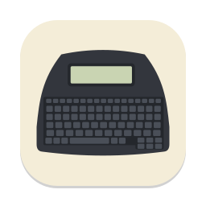

<p align="center">
  
</p>

<h1 align="center">NanoNeo</h1>

<p align="center">Plug in your AlphaSmart Neo, and your drafts appear on your Mac.</p>

<p align="center">
  <a href="https://github.com/duggan/NanoNeo/actions/workflows/ci.yml"></a>
  <a href="https://github.com/duggan/NanoNeo/releases/latest"></a>
  <a href="LICENSE"></a>
</p>

NanoNeo is a macOS menu bar app for the [AlphaSmart Neo and Neo 2](https://en.wikipedia.org/wiki/AlphaSmart).
When you connect the Neo over USB, NanoNeo saves each of its AlphaWord files to your Mac as a
plain text file. You don't need to press **Send** and wait while the Neo types your text out a
keystroke at a time.

It treats the Neo as an inbox: you draft on the Neo, and the writing moves to your Mac. Each new
draft is saved as a new file, such as `~/Documents/Neo/2026-10-12 2104 The lighthouse keeper.txt`.
Only after the file has been written and read back does NanoNeo clear that slot on the Neo, ready
for the next draft. You can turn clearing off if you'd rather keep your files on the Neo.

## Install

Download `NanoNeo.dmg` from the [latest release](https://github.com/duggan/NanoNeo/releases/latest)
and drag NanoNeo to Applications. It's signed and notarized. It needs macOS 14 or later and runs
natively on Apple silicon and Intel.

There are no drivers to install and no permissions to grant.

## Use

Launch NanoNeo and plug in your Neo. NanoNeo syncs on its own, and the Neo's screen blinks in the
menu bar icon while it does. A notification lists what was saved. The menu also has **Sync Now**,
**Open Folder**, and **Settings**, where you can choose the folder, turn off clearing or
automatic syncing, and launch NanoNeo at login.

## What it does

- **Saves safely:** each draft goes to a new file, which is flushed to disk and read back before
  anything on the Neo is touched. NanoNeo never overwrites or deletes a file on your Mac.
- **Clears only what it saved:** a slot is cleared only once its own file has been checked. If a
  clear fails, the next sync recognises the text as already saved, so it doesn't save it twice,
  and tries the clear again.
- **Needs no permissions:** the Neo connects as a USB keyboard. NanoNeo switches it into transfer
  mode with raw USB control requests, so it doesn't need Input Monitoring, root, or a driver.
  Afterwards it restarts the Neo back into keyboard mode.
- **Converts the text:** AlphaWord's character set is converted to UTF-8, one line per paragraph.

NanoNeo syncs the eight AlphaWord slots. It doesn't touch other applets, and it never sends text
to the Neo.

## Tested devices

So far it has been tested on a Neo 2 running System 3 Neo 3.4. Other Neo models and firmware use
the same protocol and should work. If you try one, please
[open an issue](https://github.com/duggan/NanoNeo/issues) and say how it went.

## Development

You need Xcode 16 or later and a Developer ID signing identity. `make dmg` also needs
`create-dmg`, and `make icons` needs Inkscape.

```sh
make run       # build a universal app, sign it, and launch it
make test      # unit tests (no Neo needed)
make release   # notarized DMG (run `make notary-setup` once first)
```

The `nanoneo` command-line tool (`swift run nanoneo`) talks to the Neo directly, for working on
the protocol: `info`, `list`, `read`, `sync --no-clear` and more.
[CLAUDE.md](CLAUDE.md) has detailed notes on the protocol and the hardware.

## Credits

NanoNeo's USB protocol code is a Swift port of [neotools](https://github.com/lykahb/neotools) by
Borys Lykah. neotools is based on [AlphaSync](https://github.com/tSoniq/alphasync) by tSoniq, the
original Mac driver. AlphaSmart and Neo are trademarks of their owners. NanoNeo is an independent
project and isn't affiliated with them.

## License

[GPL-3.0](LICENSE)
